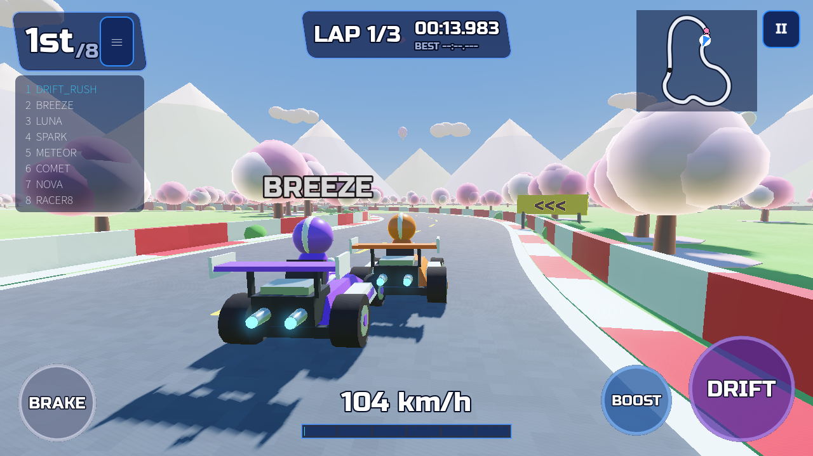

# DRIFT RUSH — Godot 4.7.2 모바일 3D 카트 레이싱

벚꽃 트랙 **Sakura Valley**를 실제로 달릴 수 있는 3D 카트 레이싱 게임입니다. 자동 가속, 기울기 조향, 드리프트, 부스터, 충돌 진동/효과음, 스피드전·아이템전(오프라인 봇), 2~8인 LAN 멀티플레이를 지원합니다.
Godot **4.7.2 Stable** 표준 빌드와 **GDScript**만 씁니다(Unity, C#, WebView 사용 안 함). 모든 3D 메쉬·사운드는 코드로 직접 생성하므로 외부 에셋이 없고, 폰트 2종만 OFL 라이선스입니다.



| 데모 영상 | `Docs/demo/drift_rush_demo.mp4` (30초, Movie Maker로 실제 렌더링) |
|---|---|
| 스크린샷 | `Docs/screenshots/*.png` (Xvfb + OpenGL에서 실제 렌더링) |

## 1. 실행 환경
- Godot **4.7.2.stable.official** (검증 바이너리: `4.7.2.stable.official.ed1daf0bf`)
- 렌더러: Mobile(기본), 저사양 기기는 Compatibility(OpenGL)로 자동 대체 (`rendering_device/fallback_to_opengl3=true`)
- Android 빌드: Android SDK(build-tools 35, platform 35), JDK 17 이상(검증은 21), Godot export templates 4.7.2
- iOS 빌드: macOS + Xcode (Linux에서는 Xcode 프로젝트 생성까지만 가능)

## 2. 실행 방법
```bash
# 에디터로 열기
godot --path DRIFT_RUSH_GODOT --editor
# 바로 실행 (로그인 → 로비)
godot --path DRIFT_RUSH_GODOT
# 레이스 씬 바로 실행 (개발용 단축)
godot --path DRIFT_RUSH_GODOT res://Scenes/Race/RaceWorld.tscn -- --mode=speed --bots=7 --map=sakura_valley
```
처음 열 때 폰트 임포트로 몇 초 걸립니다. 클래스 캐시가 없다는 오류가 나면 `godot --headless --path . --import`를 한 번 실행하세요.

## 3. PC 키보드 조작 (데스크톱 대체 조작)
| 동작 | 키 | 모바일 |
|---|---|---|
| 가속 | **자동** (출발 신호 후 항상) | 자동 |
| 좌/우 조향 | `A`/`D` 또는 `←`/`→` | 기기 기울이기 / 터치 ◀ ▶ |
| 브레이크 | `S` 또는 `↓` (누르는 동안) | 좌하단 BRAKE |
| 드리프트 | `Space` 또는 `Shift` (누른 채 조향) | 우하단 DRIFT |
| 부스터 | `W`/`↑`/`B` (게이지 가득 찼을 때) | 우하단 BOOST |
| 아이템 | `E` 또는 `Ctrl` | 좌하단 ITEM |
| 일시정지 | `Esc`/`P` | 우상단 II |

마우스 클릭도 터치로 인식되므로(`emulate_touch_from_mouse`) PC에서 화면 버튼을 눌러 볼 수 있습니다.

## 4. 테스트
```bash
cd DRIFT_RUSH_GODOT
godot --headless --path . --import                                         # 최초 1회
godot --headless --path . res://Tools/CheckAll.tscn                        # 모든 스크립트·씬 로드 검사
godot --headless --fixed-fps 60 --path . res://Tests/TestRunner.tscn       # 단위·통합 테스트 45개
Tools/run_net_test.sh 150 0.03                                             # 2프로세스 LAN 레이스 (지연 150ms, 손실 3%)
Tools/run_net_test.sh 0 0 12                                               # 경기 중 12초에 클라이언트 이탈 → DNF
SCENARIO=dedicated Tools/run_net_test.sh                                   # 전용 서버 + 클라이언트 2 (코드 검색 참가)
SCENARIO=items Tools/run_net_test.sh                                       # 온라인 아이템전 (서버 판정)
SCENARIO=cheat Tools/run_net_test.sh                                       # 순간이동 치트 → 서버 위치 보정
(cd Backend/functions && npm test)                                         # Cloud Functions 방 규칙 테스트
xvfb-run -a godot --rendering-method gl_compatibility --fixed-fps 30 --path . res://Tools/Capture.tscn -- --autopilot   # 스크린샷
```
결과는 `Docs/QA_REPORT.md`에 있습니다.

## 5. Android 빌드
1. 에디터 설정 → Export → Android에서 Android SDK 경로, Java SDK 경로, 디버그 키스토어를 지정합니다. Godot 4.7.2 export templates도 설치합니다.
2. 디버그 APK:
   ```bash
   godot --headless --path . --export-debug "Android" Build/android/DriftRush-debug.apk
   adb install -r Build/android/DriftRush-debug.apk
   ```
3. 릴리스/AAB: `export_presets.cfg`의 `keystore/release*`는 **비워 두고 커밋**합니다. 비밀번호는 에디터나 환경변수 `GODOT_ANDROID_KEYSTORE_RELEASE_PATH/USER/PASSWORD`로 넣습니다. AAB는 `gradle_build/use_gradle_build=true`, `export_format=1`로 바꾼 뒤 Gradle 빌드 템플릿을 설치해야 합니다(이 세션에서는 미검증).

## 6. iOS 빌드
1. macOS에서 Xcode와 Godot 4.7.2 export templates를 설치합니다.
2. `export_presets.cfg` → iOS → `application/app_store_team_id`에 본인 팀 ID를 넣습니다(저장소에는 비어 있음).
3. `godot --headless --path . --export-debug "iOS" Build/ios/DriftRush.ipa`로 Xcode 프로젝트를 만든 뒤 Xcode에서 서명하고 기기에서 실행합니다.

## 7. Firebase 연결
기본값은 `MockBackend`입니다(UI에 "MOCK 백엔드 · Firebase 미연결"이라고 표시됨). `Config/firebase_config.example.json`을 `Config/firebase_config.json`으로 복사해 값을 채우면 `FirebaseAdapter`(REST)로 전환됩니다. 자세한 절차는 `Docs/FIREBASE_SETUP.md`를 보세요.

## 8. 친구와 대전
**같은 Wi-Fi (LAN)**
1. 한 명이 **FRIENDS → 방 만들기(호스트)**를 누르면 6자리 **ROOM CODE**가 생깁니다.
2. 친구들은 **코드로 참가**에 그 코드를 넣거나, **근처 방** 목록에서 고릅니다. IP를 몰라도 됩니다(주소로 참가도 가능).
3. 모두 READY를 누르면 방장이 START합니다(2~8명). 방에서 스피드전/아이템전, 맵, 랩 수를 고릅니다.

**전용 서버 (인터넷 대전용)**

헤드리스 서버를 띄우면 방장 없이 전원 READY 시 자동으로 시작합니다.
```bash
godot --headless --path . -- --server --port=7777 --mode=speed --map=sakura_valley --laps=3
# 또는 내보낸 Linux 빌드:  ./DriftRush.x86_64 --headless -- --server --port=7777
```
클라이언트는 **주소로 참가**에 서버 IP를 넣습니다(같은 네트워크면 코드로도 찾을 수 있음). 인터넷에서 쓰려면 UDP 7777을 연 VM이 필요하며, 비용이 들기 때문에 이 작업에서는 만들지 않았습니다.

서버가 랩·순위·아이템 획득/명중을 판정하고, 클라이언트가 보낸 위치가 물리적으로 불가능하면(순간이동, 트랙 밖, 맵 아래) 거부하고 위치를 되돌립니다.

## 9. 폴더 구조
```
Scenes/  App, UI(13), Tracks(SakuraValley, NeonCity), Vehicles(KartBase), Race(RaceWorld)
Scripts/ Core · Input · Vehicles · Race · Tracks · Feedback · Net · Backend · UI
Data/    kart_stats.json (가속/최고속 등 튜닝), items.json, maps.json
Backend/ functions(Cloud Functions + 테스트), firestore.rules, database.rules.json, firebase.json
Tests/   TestRunner + unit/test_*.gd
Tools/   CheckAll, Capture(스크린샷), NetTest(2프로세스 네트워크 테스트)
Docs/    ARCHITECTURE, GAMEPLAY_SPEC, PROGRESS, QA_REPORT, BUILD_REPORT, FIREBASE_SETUP, OPEN_ISSUES
```
